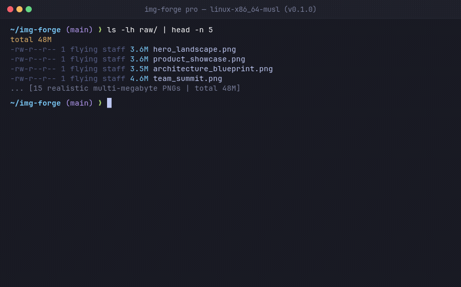

# img-forge



Fast, multi-threaded CLI for converting folders of PNG and JPEG images to modern WebP and AVIF.
Generates responsive breakpoint sets, strips EXIF/GPS metadata, and preserves folder structures without upscaling smaller assets.

> ### 📦 img-forge Pro Pack ($4.50) — [ko-fi.com/s/733df2f59f](https://ko-fi.com/s/733df2f59f)
>
> Skip local toolchains and unlock framework presets, watcher mode, and pre-compiled binaries:
> - **Pre-compiled static binaries** (Linux `x86_64` musl, Windows `x86_64` `.exe`, macOS `arm64`) — zero external C libraries or system runtimes needed
> - **`--watch` mode** — debounced hot-folder conversion as images are saved in your editor
> - **5 production presets** (`astro.toml`, `nextjs.toml`, `hugo.toml`, `ecommerce.toml`, `opengraph.toml`) + [`HOOKS.md`](./HOOKS.md) for Astro, Next.js, Hugo, Jekyll, and WordPress
> - **Automatic `snippets.html` & `manifest.json`** — ready-to-paste `<picture srcset="...">` markup and JSON asset manifests
> - **Full Rust source code** & [`THIRD_PARTY_NOTICES.md`](./THIRD_PARTY_NOTICES.md) under GNU AGPL-3.0

---

## Real-World Benchmarks

Measured on a dual-core test runner (`RAYON_NUM_THREADS=2 CARGO_BUILD_JOBS=2`):

### 4K Photographic PNG (3840×2160, 13.12 MB)

| Target Format | Output Widths | Output Size | Compression | Encode Time | Peak RAM (RSS) |
| :--- | :--- | :--- | :--- | :--- | :--- |
| **WebP** (`zenwebp`, q=80) | 3840px (original) | **1.13 MB** | **-91.4%** | 1,549 ms | 100.6 MB |
| **AVIF** (`ravif`, q=80) | 3840px (original) | **0.88 MB** | **-93.3%** | 12,376 ms | 361.6 MB |
| **WebP + AVIF Set** | 480w, 960w, 1920w (6 files) | **0.59 MB** total | **-95.5%** | 6,553 ms | 137.9 MB |

### Framework Preset Test Run (1.19 MB source dataset)

| Preset | Target Breakpoints | Output Files | Total Output | Time | Peak RAM |
| :--- | :--- | :--- | :--- | :--- | :--- |
| `hugo.toml` | 480w, 960w, 1440w (WebP, HTML) | 6 files | 0.30 MB | 749 ms | 54.8 MB |
| `opengraph.toml` | 1200w (WebP, Manifest) | 4 files | 0.28 MB | 467 ms | 47.1 MB |
| `ecommerce.toml` | 400w, 800w, 1600w (WebP+AVIF, HTML+Manifest) | 14 files | 0.99 MB | 7,103 ms | 129.0 MB |
| `astro.toml` | 480w, 960w, 1920w (WebP+AVIF, HTML+Manifest) | 12 files | 1.05 MB | 8,212 ms | 150.3 MB |
| `nextjs.toml` | 640w, 1080w, 1920w (WebP+AVIF, Manifest) | 11 files | 1.26 MB | 9,466 ms | 150.8 MB |

---

## Free vs. Pro Feature Comparison

| Feature | Free (Community) | Pro ($4.50 on Ko-fi) |
| :--- | :---: | :---: |
| **Supported Inputs** | PNG, JPEG (`.png`, `.jpg`, `.jpeg`) | PNG, JPEG (`.png`, `.jpg`, `.jpeg`) |
| **Output Formats** | WebP (`zenwebp`), AVIF (`ravif`) | WebP (`zenwebp`), AVIF (`ravif`) |
| **Responsive Resizing** | Multi-width (never upscales) | Multi-width (never upscales) |
| **EXIF & GPS Stripping** | Automatic | Automatic |
| **Parallel Processing** | Multi-core via `rayon` | Multi-core via `rayon` |
| **Nested Folder Hierarchy** | Preserved in output | Preserved in output |
| **Distribution** | Compile via Cargo | Pre-compiled static binaries (Linux musl, Win, macOS) |
| **Preset Configurations** | Manual CLI flags | `--preset` (`.toml`) with 5 framework presets |
| **HTML `<picture>` Generation** | Manual | Automatic `snippets.html` |
| **Asset Manifest** | Manual | Automatic `manifest.json` |
| **Hot-Folder File Watcher** | Manual re-run | `--watch` debounced watcher |
| **Framework Integration Guide** | Basic README | Comprehensive [`HOOKS.md`](./HOOKS.md) |
| **License** | AGPL-3.0 | AGPL-3.0 (Full source + pre-compiled bundle) |

---

## Installation

### Option A: Pre-compiled Static Binaries (Pro Pack)

Download the pre-built standalone binary for Linux (`x86_64` musl), macOS (`arm64`), or Windows (`x86_64` `.exe`) from [Ko-fi ($4.50)](https://ko-fi.com/s/733df2f59f). Zero system dependencies or external C libraries required.

### Option B: Build from Source with Cargo

Requires a local Rust toolchain:

**Free Edition**:
```sh
cargo install --path .
```

**Pro Edition (compiling from source)**:
```sh
cargo install --path . --features pro
```

---

## Usage

### Basic CLI Commands

Convert a folder of PNG/JPEG images to WebP and AVIF across responsive widths:
```sh
img-forge ./raw ./out --webp --avif --quality 80 --widths 480,960,1920
```

WebP only, keeping original width:
```sh
img-forge ./raw ./out --webp
```

AVIF only at quality 75:
```sh
img-forge ./raw ./out --avif --quality 75 --widths 640,1280
```

### CLI Flags

| Flag | Description | Default |
| :--- | :--- | :--- |
| `<INPUT_DIR>` | Path to folder containing source PNG/JPEG images | *Required* |
| `<OUTPUT_DIR>` | Destination directory for converted assets | *Required* (optional if defined in `--preset`) |
| `--webp` | Emit WebP images via `zenwebp` | Disabled |
| `--avif` | Emit AVIF images via `ravif` | Disabled |
| `--quality <1-100>` | Encoder quality setting | `80` |
| `--widths <LIST>` | Comma-separated target widths (never upscales smaller images) | Original width |
| `--preset <PATH>` | *(Pro feature)* Load configuration from a `.toml` preset file | None |
| `--watch` | *(Pro feature)* Watch `<INPUT_DIR>` for changes and convert on save | Disabled |

*Note: At least one of `--webp`, `--avif`, or a `--preset` specifying formats is required.*

---

## Pro Mode Usage

### Framework Presets

Run batch conversions using framework presets (emits `snippets.html` and `manifest.json` when enabled in the preset):

```sh
# Destination is read from astro.toml (./public/images)
img-forge ./raw --preset ./presets/astro.toml

# Override destination directory if desired
img-forge ./raw ./custom-out --preset ./presets/nextjs.toml
```

See [`HOOKS.md`](./HOOKS.md) for full integration recipes with Astro, Next.js, Hugo, Jekyll, and WordPress.

### Hot-Folder Watch Mode

Watch a folder for new or modified images and convert them automatically with debounce handling:

```sh
img-forge ./raw ./out --webp --avif --widths 480,960,1920 --watch
```

*Note: Incremental `--watch` processes newly saved and updated images. Static `snippets.html` and `manifest.json` generation runs during full batch processing.*

---

## License & Third-Party Notices

`img-forge` is licensed under the **GNU Affero General Public License v3.0 (AGPL-3.0)**.
Pre-compiled binaries are self-contained static builds with zero external C library dependencies.
All third-party crate licenses (MIT, Apache-2.0, BSD-2-Clause, BSD-3-Clause, CC0-1.0, Unlicense) are documented in [`THIRD_PARTY_NOTICES.md`](./THIRD_PARTY_NOTICES.md).
